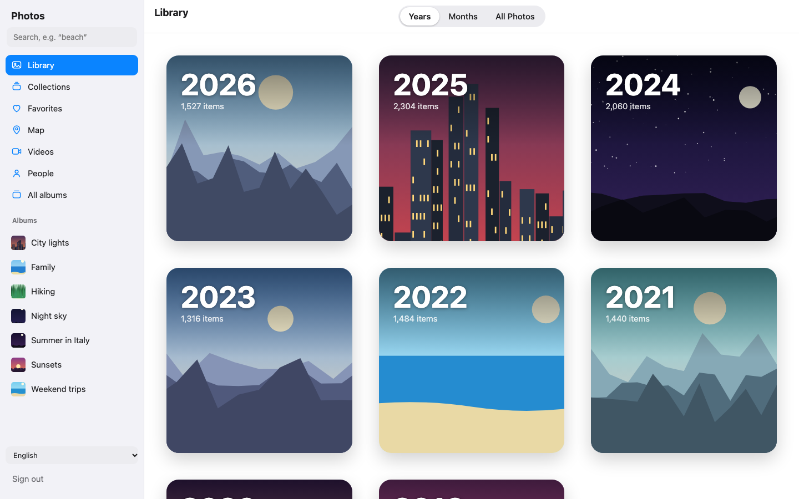
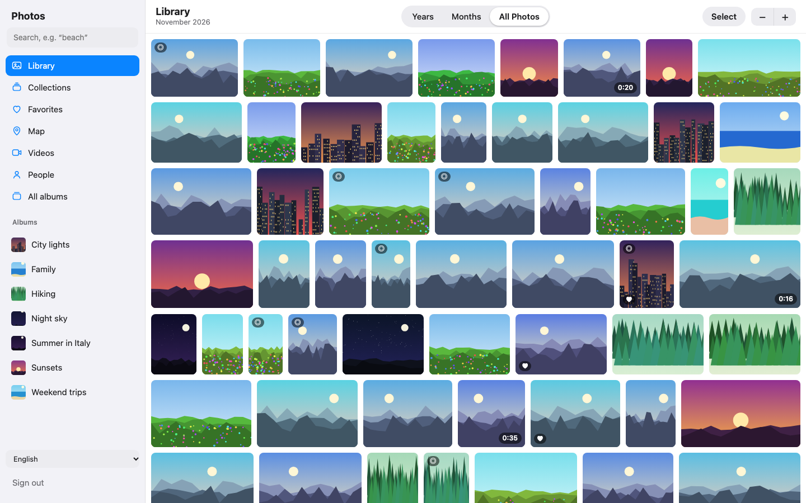
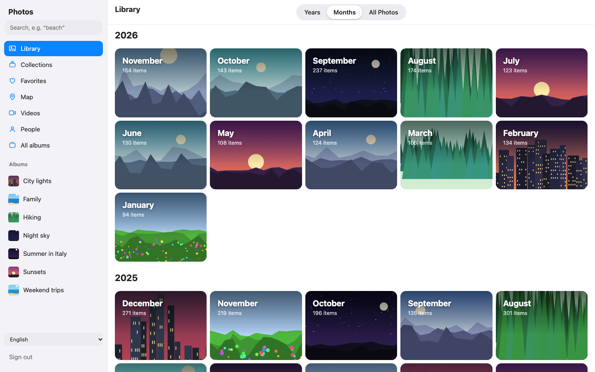
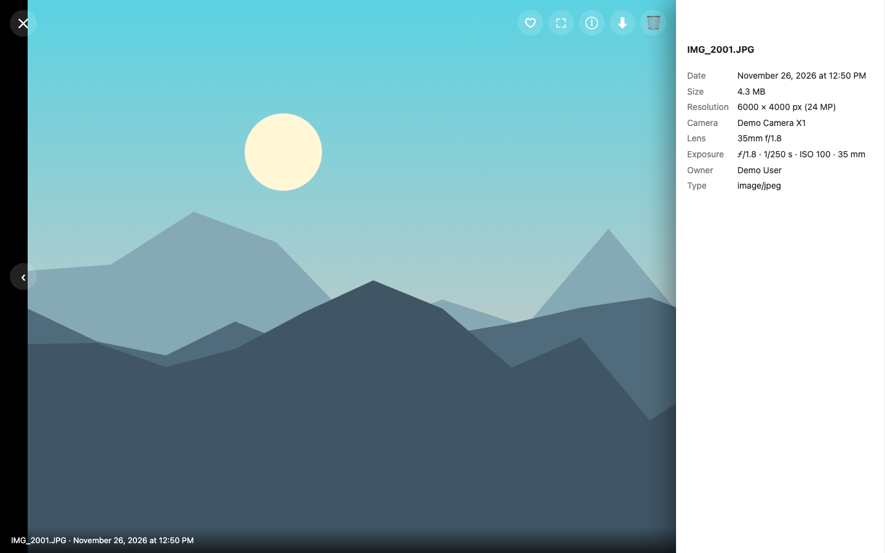
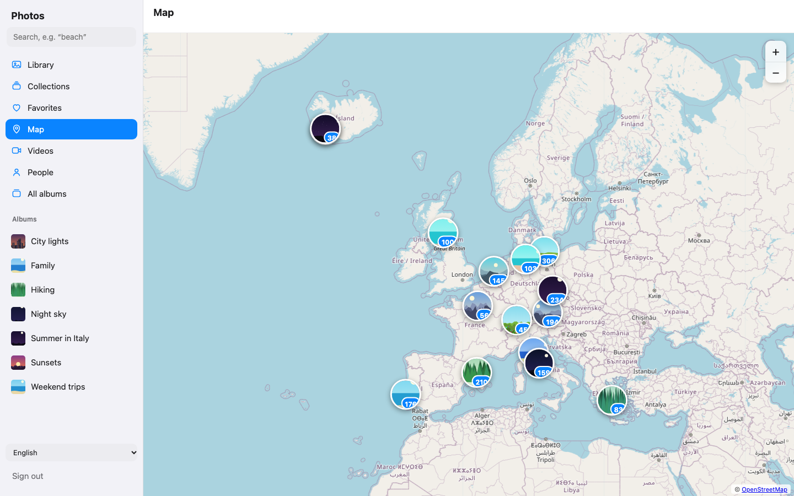
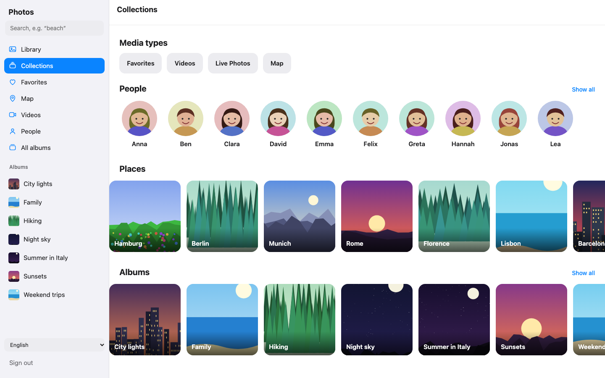
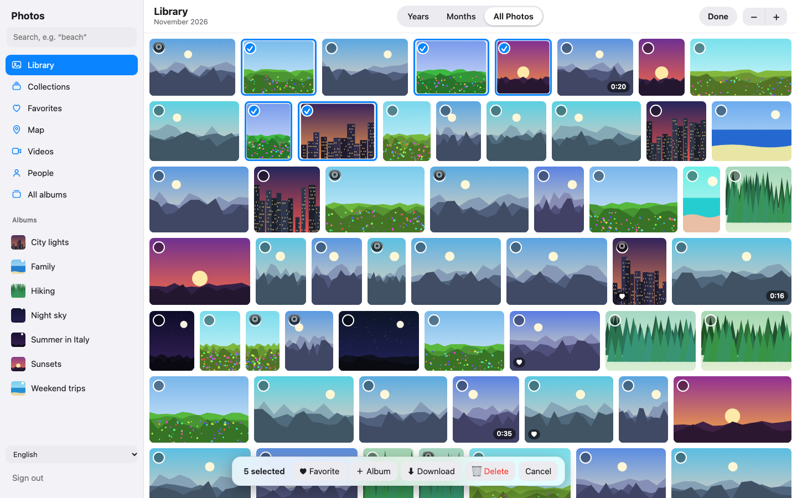
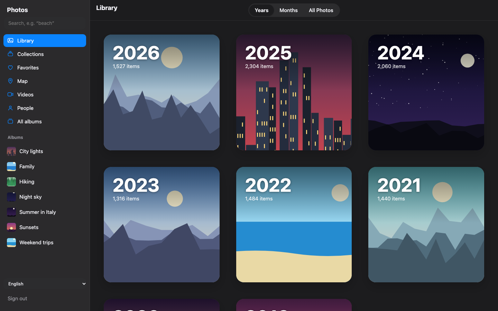

# Immich Apple-Photos Webapp

A lightweight web app for [Immich](https://immich.app/) whose look and navigation are inspired by the
Apple Photos app: **Years / Months / All Photos**, large year and month cards, a justified photo grid,
a map, people and collections.

> **Not affiliated.** This is an independent community project. It is not made, endorsed or supported
> by the Immich team or by Apple. "Apple" and "Photos" are trademarks of Apple Inc.; they are used here
> only to describe the visual inspiration. No Apple assets are included — the icon is original.

<p align="center"> </p>
<sub>Screenshots show the built-in demo mode with generated dummy pictures — no real photos.</sub>

No build step, no dependencies: plain HTML/CSS/JS plus a tiny Node proxy server.
The interface is available in **English and German**, and it is easy to [add your own language](CONTRIBUTING.md#adding-or-improving-a-translation).

## Features

- **Library** with *Years*, *Months* (cards with cover photo) and *All Photos* (justified grid, 5 zoom levels)
- Fast loading: one request per month through Immich's timeline API, next month prefetched,
  **virtualized grid** (only visible rows exist in the DOM), blurred **ThumbHash** placeholders
- Favorites, Videos, Live Photos, Albums, **Collections** (media types, people, places, albums)
- **Map** with photo clusters (OpenStreetMap tiles), **People**, **Search** (Immich smart search, filename fallback)
- **Viewer**: zoom/pan/swipe, info panel (EXIF), favorite, download, trash, fullscreen (`f`)
- **Selection mode**: favorite, add to album, download (ZIP), move to trash (with confirmation)
- Partner sharing aware (photos shared with you appear in years/months)
- Installable as a PWA over HTTPS (icon included)
- **Translatable:** English and German included; a new language is a single JSON file (see below)

## Screenshots

| | |
|---|---|
|  **Months** – cards with cover photo |  **Viewer** with info panel |
|  **Map** – photo clusters |  **Collections** – people, places, albums |
|  **Selection mode** |  **Dark mode** follows the system |

## Try it without Immich

A built-in demo mode starts a tiny fake Immich API with ~13,000 generated dummy photos, albums, people and places:

```sh
npm run demo        # http://localhost:8081 – sign in with any e-mail and password
```

It is also how the screenshots above are made (`npm run screenshots`, needs Chrome/Chromium).

## Requirements

- An Immich server (developed and tested against **v3.3.6**)
- Node.js 18+ **or** Docker

## Quick start

```sh
IMMICH_URL=http://your-immich-host:2283 node server.mjs   # http://localhost:8080
```

The server serves `public/` and proxies `/api` to Immich, so the browser talks to a single origin
(no CORS setup needed, cookies just work). Log in with your normal Immich account.

### Docker (recommended)

A ready-made multi-arch image (amd64, arm64) is published to the GitHub Container Registry:

```sh
docker run -d --name immich-photos-web -p 8090:8080 \
  -e IMMICH_URL=http://your-immich-host:2283 \
  ghcr.io/fabian1512/immich-apple-photos-webapp:latest        # http://<host>:8090
```

Or with Docker Compose next to Immich — `docker-compose.yml` joins Immich's Docker network
(`immich_default` by default) and reaches it at `http://immich_server:2283`:

```sh
docker compose up -d             # http://<host>:8090
```

Override with `IMMICH_URL`, `IMMICH_NETWORK`, `PUBLIC_PORT` (see `.env.example`). To build the image from
this checkout instead: `docker compose -f docker-compose.yml -f docker-compose.build.yml up -d --build`.
Image tags: `latest`, `0.1.0`, `0.1`.

### Deploy script

`deploy.sh` runs the checks, copies the app to a server over SSH, starts the container and tests `/healthz`.
Copy `.env.example` to `.env` and set `DEPLOY_HOST` (and optionally `DEPLOY_KEY`, `DEPLOY_DIR`), then run `./deploy.sh`.

## Languages and translations

English and German are included. The app picks the language from the browser and offers a language picker
(bottom of the sidebar and on the login page). Missing texts fall back to English.

To add a language, copy `public/locales/en.json` to `public/locales/<code>.json`, translate the values and open a
pull request — no code changes needed. Details and rules: [CONTRIBUTING.md](CONTRIBUTING.md).
Not comfortable with pull requests? Open a [translation issue](../../issues/new?template=translation.yml).

## Tests

```sh
npm test        # or: node --test test/*.test.mjs
```

Covers the grid layout maths, the ThumbHash decoder and the translation files (every key used in the code
exists, no unknown keys or placeholders in translations).

## Layout of the repository

| Path | Purpose |
|---|---|
| `server.mjs` | static file server + `/api` proxy + `/healthz` |
| `public/app.js` | UI, Immich calls, virtualized grid, map, viewer |
| `public/layout.js` | pure row-layout algorithm (unit-tested) |
| `public/thumbhash.js` | ThumbHash decoder (see `THIRD-PARTY.md`) |
| `public/i18n.js`, `public/locales/*.json` | translation layer and language files |
| `public/sw.js`, `manifest.webmanifest` | PWA shell cache and manifest |
| `demo/` | demo mode: fake Immich API, dummy picture generator, screenshot script |
| `Dockerfile`, `docker-compose.yml`, `deploy.sh` | deployment |
| `.github/workflows/` | CI (tests) and Docker image publishing on version tags |

## Good to know

- **Internal Immich API.** Year/month overviews and month loading use `/timeline/buckets` and
  `/timeline/bucket`, which Immich marks as *internal*. They can change in a future Immich release; the app
  falls back to the stable search API when they fail, but the year/month overview needs them.
- **Writes.** Favorite, add-to-album, delete (to trash) and download call the Immich API with the
  logged-in user's session. Try them on test photos first.
- **HTTPS.** Over plain `http://<ip>` browsers do not treat the page as a secure context, so there is no
  service worker and Chrome will not offer "install". Everything else works. Put a reverse proxy with a
  certificate in front if you want installation.
- **Security.** The proxy forwards only `/api/*` to the configured Immich URL. It has no authentication of
  its own — Immich's login protects everything. Do not expose it to the internet without thinking about that.
- **Map tiles** come from OpenStreetMap and need internet access (see `THIRD-PARTY.md`).

## License

[MIT](LICENSE). Third-party notices: [THIRD-PARTY.md](THIRD-PARTY.md).
